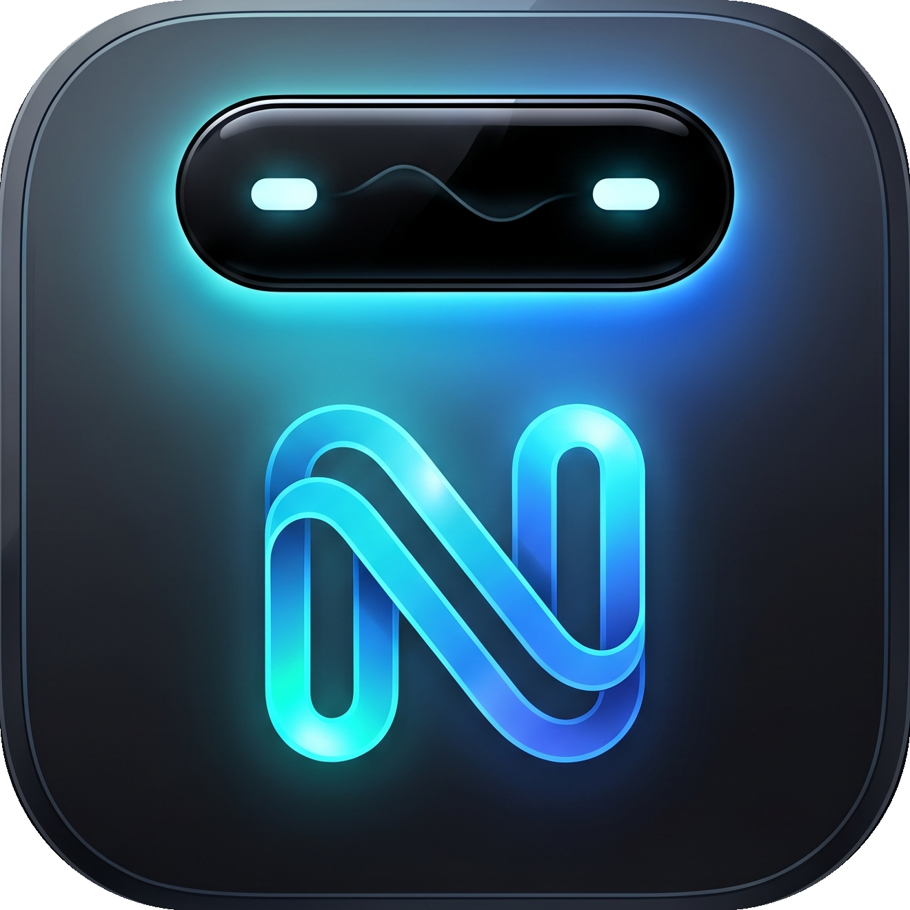
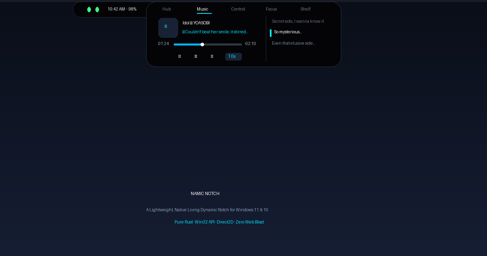

<p align="center">
  
</p>

<h1 align="center">Namic Notch</h1>

<p align="center">
  <b>A lightweight, native living dynamic notch for Windows 11 & 10.</b><br />
  Built entirely in native Rust with Win32, Direct2D, and DirectWrite. Zero Electron. Zero web bloat. Under 25MB RAM.
</p>

<p align="center">
  
</p>

---

## Overview

Windows has always lacked a clean, cohesive place for ambient information. Most existing desktop widgets rely on web technologies like Electron or Chromium, which easily eat up 500MB of RAM just to show the time or currently playing music.

**Namic Notch** was built from scratch in pure Rust to fix that. It rests seamlessly against your monitor's top bezel, expanding into an interactive multi-tool when you hover over it, and collapsing back into a minimal status pill when you move your cursor away.

It integrates directly with Windows system APIs:
- **Global System Media Transport Controls (GSMTC)**: Real-time track metadata, interactive scrubbing, and speed adjustment for Spotify, YouTube (Chrome/Edge/Brave), VLC, and native media players.
- **LRCLIB Auto-Sync**: Automatic timestamped karaoke lyrics that scroll smoothly alongside your music.
- **Native Windows Audio COM**: Volume adjustments via `IAudioEndpointVolume` with zero console popups or lag.
- **Direct2D Hardware Acceleration**: Fluid 60–120 FPS spring-physics animations with sub-millisecond frame rendering and virtually 0% idle CPU usage.

---

## Visual Tour & Interfaces

### 1. Minimal Pill (Idle / Mascot State)

When idle or while you are working, Namic Notch sits quietly at the top edge of your screen. It displays the time, battery percentage, charging state, or an optional animated mascot with glowing illuminated eyes.

```text
┌─────────────────────────────────────────────────────────────┐  <-- Top Screen Bezel
│       [  ●  ●  ]   10:42 AM  ·  98% [⚡]                    │  (Collapsed: 156 x 34 px)
└─────────────────────────────────────────────────────────────┘
```

- **Smart Click-Through**: Outside the pill boundaries, mouse clicks pass through completely to whatever window is behind it (`WS_EX_TRANSPARENT` dynamic hit-testing).
- **No Focus Stealing**: Clicking or interacting with the notch never defocuses your active game, code editor, or document (`WS_EX_NOACTIVATE`).

---

### 2. Music Player & Flowing Karaoke Lyrics

Expanding the notch opens the media section with comprehensive playback controls:

```text
┌──────────────────────────────────────────────────────────────────────────────────┐
│  ‹    Hub    [ Music ]    Control    Focus    Shelf    Stages                   › │
├──────────────────────────────────────────────────────┬───────────────────────────┤
│  ┌───────┐  Idol — YOASOBI                           │  Secret side, I wanna...  │
│  │   ♫   │  ♪ Couldn't beat her smile; it stirred... │ ▌So mysterious...         │
│  └───────┘                                           │  Even that elusive side.. │
│  01:24  ───────────●───────────────────  -02:10      │                           │
│              ⏮     ⏸     ⏭     [ 1.0x ]              │  [ 💬 Toggle Lyrics ]     │
└──────────────────────────────────────────────────────┴───────────────────────────┘
```

- **Interactive Scrubbing**: Click or drag anywhere along the timeline bar to jump directly to that timestamp in Spotify, YouTube, or your media player.
- **Quick Stepping (+5s / -5s)**:
  - Click the elapsed time (`01:24`) to step back 5 seconds.
  - Click the remaining time (`-02:10`) to skip forward 5 seconds.
  - Mouse wheel scrolling anywhere over the music panel steps forward or backward 5 seconds.
- **Playback Speed**: Click the speed badge (`1.0x`) to cycle between `1.0x`, `1.25x`, `1.5x`, `2.0x`, and `0.75x`.
- **Karaoke Flow**: Synchronized lyrics glide into view with a highlighted active-line indicator. Clicking any lyric line jumps playback directly to that verse.

---

### 3. Quick System Controls

Instant sliders for master audio volume and screen brightness without opening Windows Action Center:

```text
┌──────────────────────────────────────────────────────────────────────────────────┐
│  ‹    Hub    Music    [ Control ]    Focus    Shelf    Stages                   › │
├──────────────────────────────────────────────────────────────────────────────────┤
│   🔊 Volume        72%  ═════════════════════════●─────────────                  │
│   🔆 Brightness    80%  ════════════════════════════════●──────                  │
└──────────────────────────────────────────────────────────────────────────────────┘
```

- Click or scroll on either bar to make instant hardware-level adjustments.

---

### 4. Focus & Pomodoro Timer

A distraction-free timer built right into the notch to keep you on schedule:

```text
┌──────────────────────────────────────────────────────────────────────────────────┐
│  ‹    Hub    Music    Control    [ Focus ]    Shelf    Stages                   › │
├──────────────────────────────────────────────────────────────────────────────────┤
│     24:18               [ 🎯 Focus 25m ]    [ ☕ Break 5m ]                      │
│     Focus Session       [ ▶ Resume ]        [ ↺ Reset ]                          │
└──────────────────────────────────────────────────────────────────────────────────┘
```

---

### 5. Quick Shelf

A temporary drop area for files, screenshots, or documents you want to keep handy:

```text
┌──────────────────────────────────────────────────────────────────────────────────┐
│  ‹    Hub    Music    Control    Focus    [ Shelf ]    Stages                   › │
├──────────────────────────────────────────────────────────────────────────────────┤
│   Drag & drop any file here to pin it temporarily to your top screen bezel       │
│   📄 project-spec.pdf · 1.4 MB               [ Open ]  [ Copy ]  [ Clear ]       │
└──────────────────────────────────────────────────────────────────────────────────┘
```

---

## Keyboard & Mouse Shortcuts

| Action | Gesture / Shortcut |
|---|---|
| **Expand Notch** | Move mouse cursor near the top center bezel |
| **Collapse Notch** | Move cursor away from the notch |
| **Switch Tabs** | Click the tab names (`Hub`, `Music`, `Control`, `Focus`, `Shelf`) or `‹` / `›` buttons |
| **Seek Music Timeline** | Click or drag across the progress track bar |
| **Fast Forward (+5s)** | Click remaining time on the right, or scroll mouse wheel up |
| **Rewind (-5s)** | Click elapsed time on the left, or scroll mouse wheel down |
| **Change Playback Speed** | Click the `[ 1.0x ]` badge |
| **Volume Adjustment** | Click or scroll on the volume track bar in `Control` |
| **Pin / Drop File** | Drag and drop files from Windows Explorer onto the notch |
| **System Tray Menu** | Right-click the Namic Notch icon in the Windows taskbar tray |

---

## Getting Started

### Method 1: Installer (Recommended for Most Users)

1. Download `NamicNotchSetup_v1.0.0.exe` from the Releases page.
2. Run the setup installer. It will install Namic Notch to your local user directory without requiring administrative rights.
3. Check **Start with Windows** if you'd like Namic Notch to launch automatically when you log in.

### Method 2: Portable Executable

1. Download the standalone `nusa.exe` (or `namic.exe`).
2. Place it in any directory of your choice and double-click to run.
3. Namic Notch will start in the background and sit quietly at the top of your screen.

---

## Building From Source

### Prerequisites

- Windows 10 (version 1903 or later) or Windows 11
- Rust toolchain (stable, 1.75+)
- Inno Setup 6 (optional, only needed if compiling the installer)

### Build Instructions

```bash
# 1. Clone this repository
git clone https://github.com/ImmanuelDeo/NamicNotch.git
cd NamicNotch

# 2. Check and compile
cargo check
cargo build --release

# 3. The release binary will be available at:
# target/release/nusa-clone.exe

# 4. (Optional) Build the Inno Setup installer:
iscc NamicNotchSetup.iss
```

---

## Architecture & Technical Details

- **Language**: Rust 2021 edition
- **Window Management**: Native Win32 API (`CreateWindowExW` with `WS_EX_LAYERED | WS_EX_TOPMOST | WS_EX_TOOLWINDOW | WS_EX_ACCEPTFILES | WS_EX_NOACTIVATE`)
- **Composition**: Windows DWM (`DwmExtendFrameIntoClientArea` with `-1` margins)
- **Renderer**: Direct2D 1.1 + DirectWrite for anti-aliased sub-pixel vector rendering
- **Media Poller**: `windows::Media::Control::GlobalSystemMediaTransportControlsSessionManager`
- **Audio Control**: Windows Core Audio API (`IMMDeviceEnumerator` + `IAudioEndpointVolume`)
- **Lyrics Engine**: LRCLIB HTTP client with smart title cleaning and sub-second timestamp interpolation
- **Spring Physics**: Critically damped spring simulation for all geometric transitions (width, height, corner radius, alpha)

---

## License

This project is licensed under the MIT License — see the [LICENSE.txt](LICENSE.txt) file for details.