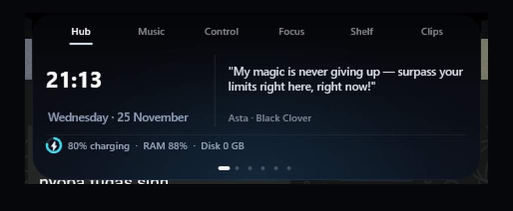
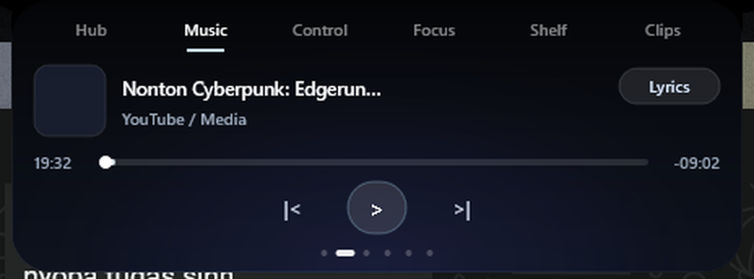
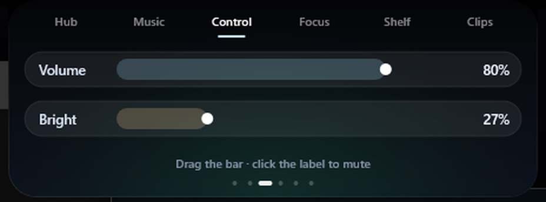
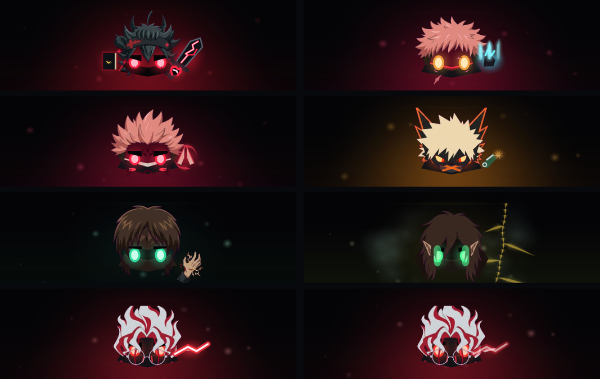

# Namic Notch

A notch for Windows that lives at the top edge of the screen: a black pill that
expands into a small control surface with music, volume, brightness, a Pomodoro
timer, a file shelf and clipboard history. Written in Rust against Win32 and
Direct2D — no Electron, no WebView, no runtime to install.

<p align="center">
  
</p>

## What it is

The expanded notch is one glass surface with six panes. You switch panes with
the tab strip at the top or the dots at the bottom. Nothing is a web page; every
element is drawn by Direct2D at the native DPI.

| Pane | What it holds |
| --- | --- |
| Hub | Clock, date, a rotating quote, battery and disk summary |
| Music | Cover art from the system media session, seek bar, transport, synced lyrics |
| Control | Volume and brightness sliders, wired to the real endpoints |
| Focus | Pomodoro with 25 / 5 minute modes and a progress line |
| Shelf | Drag files in, click to open, drag them back out |
| Clips | Clipboard history plus short notes, click an entry to copy it again |

<p align="center">
  
  
</p>

## Mascots

Six characters idle behind the collapsed pill, each with its own draw code and
VFX, plus PNG head overlays for three of them. They are drawn, not animated
video: the same renderer that draws the notch draws the characters.

<p align="center">
  
</p>

## Requirements

- Windows 10 21H2 or newer, x64
- No runtime required for the installer build

Building from source needs the MSVC toolchain, see [docs/BUILD.md](docs/BUILD.md).

## Install

Two shapes, pick one:

- **Installer** — `installer/NamicNotchSetup.iss` builds a setup executable with
  Inno Setup; default target is `D:\NamicNotch`.
- **Portable** — copy `nusa.exe` and the `assets` folder anywhere.

Autostart is a single registry value under
`HKCU\Software\Microsoft\Windows\CurrentVersion\Run`. There is no second launch
path, so the app cannot start twice.

## Build

```powershell
cargo build --release
# binary: target\release\nusa-clone.exe
```

The headless renderer used for the mascot frames lives in `snaptop/`:

```powershell
cd snaptop
cargo run --release -- D:\NusaNotch-RE\snapshots
```

## How it is put together

- `src/notch/` — window, input, state machine, Direct2D renderer
- `src/mascot/` — characters, shared drawing helpers, VFX, PNG head loader
- `src/media/` — GSMTC session handling
- `src/clipboard/`, `src/shelf/`, `src/timers/`, `src/settings/`, `src/tray/`

Details, including the layer mask that keeps glow inside the pill and the
geometry used to merge the notch into the top screen edge, are in
[docs/ARCHITECTURE.md](docs/ARCHITECTURE.md).

## Known limits

- Cover art and synced lyrics depend on what the media app publishes through
  GSMTC. Spotify publishes artwork and position; some browser tabs publish only
  a title.
- Brightness control uses `WmiMonitorBrightnessMethods`. External monitors that
  do not implement it stay unchanged.
- Lyrics come from LRCLIB. Instrumental tracks usually have none, and the pane
  says so instead of inventing lines.
- The notch is a top-anchored window. Multi-monitor setups place it on the
  primary display only.

## Contributing

Read [CONTRIBUTING.md](CONTRIBUTING.md). Bug reports with a screenshot and the
contents of `%LOCALAPPDATA%\NamicNotch\boot.log` are welcome.

## License

MIT. See [LICENSE.txt](LICENSE.txt).
