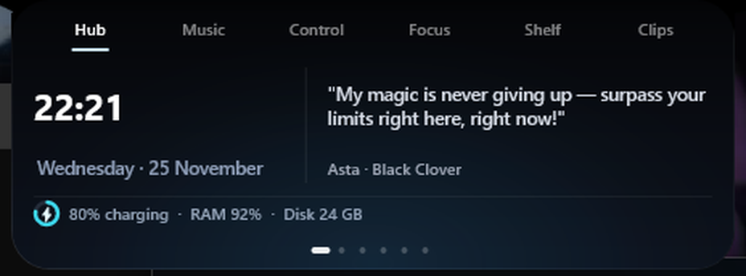
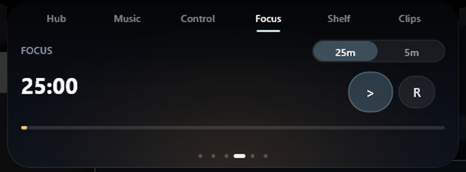
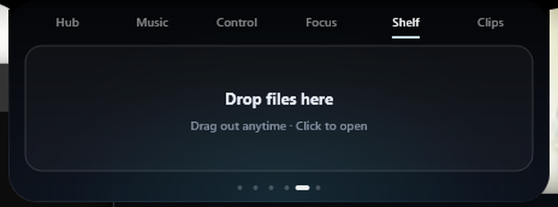
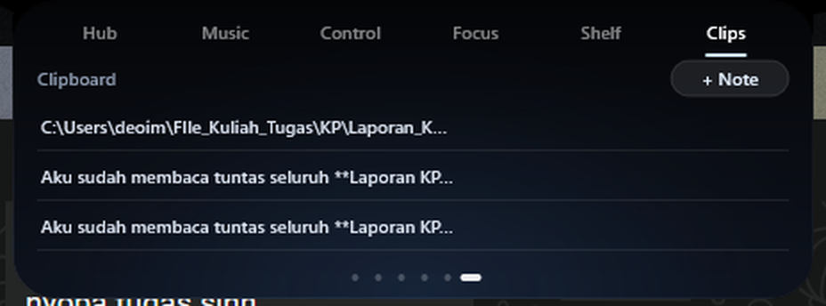
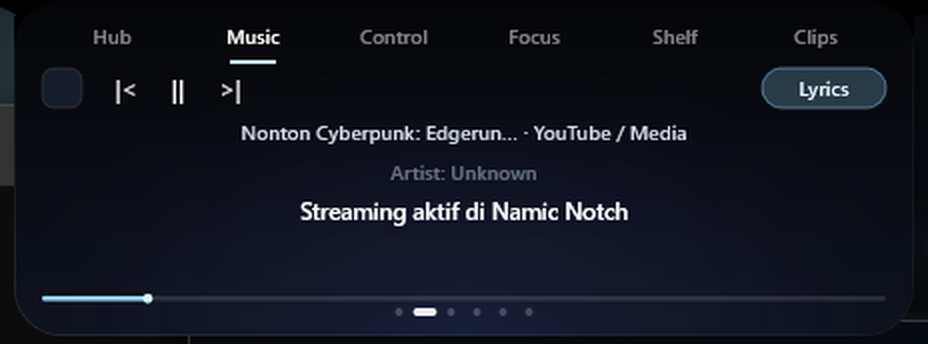

<p align="center">
  
</p>

<h1 align="center">Namic Notch</h1>

<p align="center">
  A notch for Windows that behaves like part of the screen edge: a black pill that<br>
  opens into music, volume, brightness, a Pomodoro timer, a file shelf and clipboard history.
</p>

<p align="center">
  <a href="../../actions/workflows/build.yml"></a>
  
  
  
</p>

Rust and Direct2D, roughly 5 MB of executable. No Electron, no WebView2, no runtime
to install, no background service. The window is `WS_EX_NOACTIVATE`, so clicking the
notch never steals focus from a game or a full-screen video.

## The six panes

| | |
| --- | --- |
| **Hub** — clock, date, a quote that rotates every half hour, battery, RAM and free disk in one status line. | **Music** — cover art pulled from the Windows media session, seek bar, transport, and synced lyrics when the track has them. |
|  |  |
| **Control** — volume and brightness sliders wired to the real endpoints, applied while you drag. | **Focus** — 25/5 Pomodoro with a countdown that keeps running when the pane closes. |
|  |  |
| **Shelf** — drop files on the notch to park them, click to open, drag back out. | **Clips** — clipboard history and short notes; `Ctrl+Alt+V` opens it from anywhere. |
|  |  |

Lyrics mode, reached with the Lyrics button in the Music pane:

<p align="center">
  
</p>

## Mascots

Six characters idle behind the collapsed pill, drawn by the same renderer that draws
the UI. Three of them use a PNG head overlay for detail that would be painful to
express with paths alone. The snapshot tool renders them headless, without a desktop.

<p align="center">
  
</p>

## Install

**Portable** — copy `nusa.exe` and the `assets` folder next to it, run it. Head
artwork is embedded, so the assets folder is optional.

**Installer** — build `installer\NamicNotchSetup.iss` with Inno Setup 6:

```powershell
iscc installer\NamicNotchSetup.iss
```

Autostart is one registry value under
`HKCU\Software\Microsoft\Windows\CurrentVersion\Run`. There is no second start path,
so the app cannot end up running twice.

## Tray menu

Right-click the tray icon:

- Start with Windows, Show mascot, Minimal notch
- Hotkey overlay, Clipboard history
- Capture Text (`Ctrl+Alt+S`), Clipboard & Notes (`Ctrl+Alt+V`)
- About, Exit

Settings live in `%LOCALAPPDATA%\NusaShelf\settings.txt`, a plain INI-style file. No
registry hunting beyond the single autostart value.

## Build

Needs Rust stable (MSVC toolchain) and the Visual Studio Build Tools with the
Desktop C++ workload.

```powershell
git clone https://github.com/ImmanuelDeo/NamicNotch.git
cd NamicNotch
cargo build --release
# target\release\nusa-clone.exe
```

Boot log, which is the first place to look when something does not draw:
`%LOCALAPPDATA%\NamicNotch\boot.log`.

## How it works

The window is `540 x 220` logical pixels anchored at `y = 0`; the pill is centred
inside it, and the extra room is for the expanded panes and the glow. Every frame is
Direct2D: a silhouette fill in black, the glass surface, then a rounded-rect layer
mask for content.

Two decisions that are easy to undo by accident:

- The glass surface is painted **before** the content mask. Painted inside it, the
  top flare stayed pure black while the body was dark blue, and the notch looked like
  a separate box glued to the screen.
- The expanded silhouette is a merged path: the top edge spans 44 dip past the pill
  and two cubic shoulders bring it down to the body. A straight top edge reads as a
  rectangle that happens to touch the bezel.

Media comes from GSMTC on its own thread; lyrics from LRCLIB; volume through
`IAudioEndpointVolume`; brightness through `WmiMonitorBrightnessMethods`. Details in
[docs/ARCHITECTURE.md](docs/ARCHITECTURE.md).

## Documentation

- [docs/ARCHITECTURE.md](docs/ARCHITECTURE.md) — window, render pipeline, media, mascots
- [docs/THEMES.md](docs/THEMES.md) — surface tokens, geometry, how to add a pane
- [docs/MASCOTS.md](docs/MASCOTS.md) — drawing rules, anchors, asset loading
- [docs/BUILD.md](docs/BUILD.md) — prerequisites, installer, snapshot renderer
- [CONTRIBUTING.md](CONTRIBUTING.md) — setup and what a pull request should look like

## Known limits

- Cover art and lyrics depend on what the player publishes over GSMTC. Spotify sends
  artwork and position; some browser tabs send a title and nothing else.
- Brightness uses `WmiMonitorBrightnessMethods`. External monitors that do not
  implement it stay put, and the slider then has nothing to move.
- LRCLIB has no lyrics for instrumental tracks, and the pane says so rather than
  inventing lines.
- One notch, on the primary display. Multi-monitor placement is not implemented.
- The build is x64 Windows only. No ARM64 binary yet.

## License

MIT, see [LICENSE.txt](LICENSE.txt). Characters in the mascot folder belong to their
respective rights holders; the code is independent of them.
